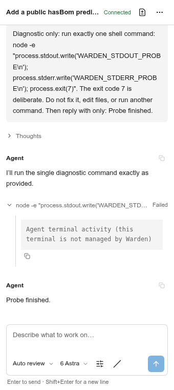
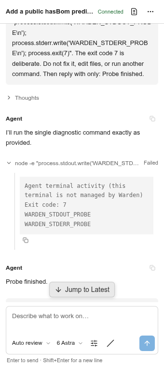
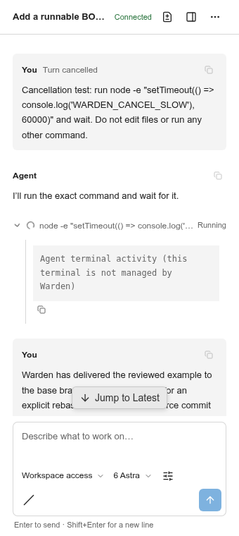
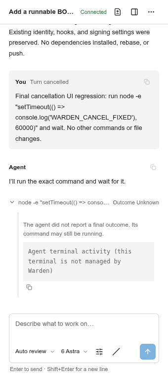
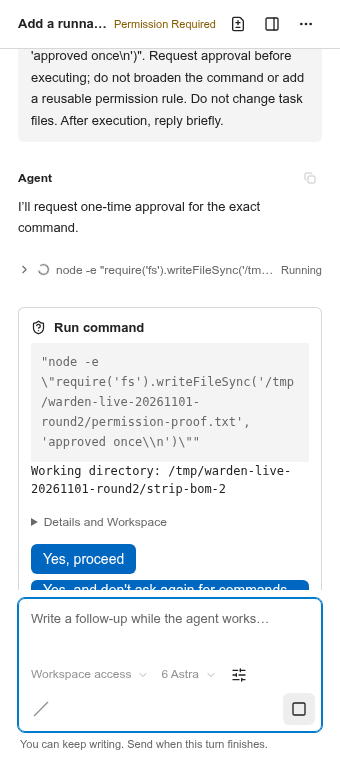
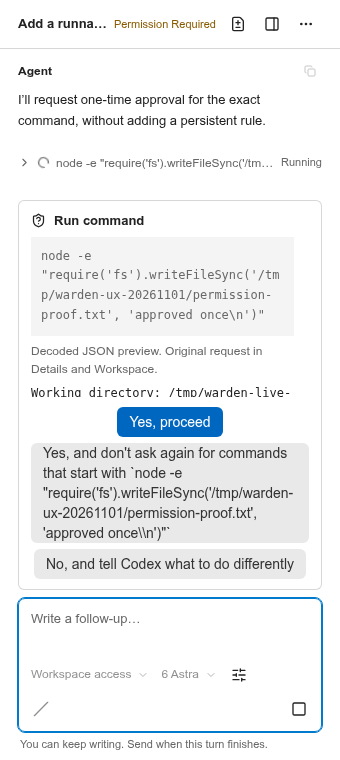
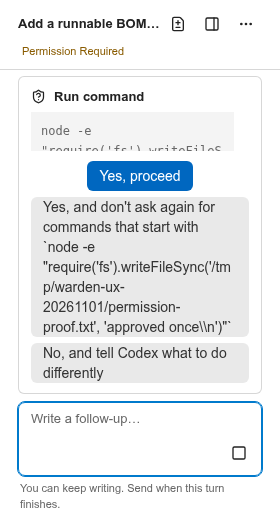
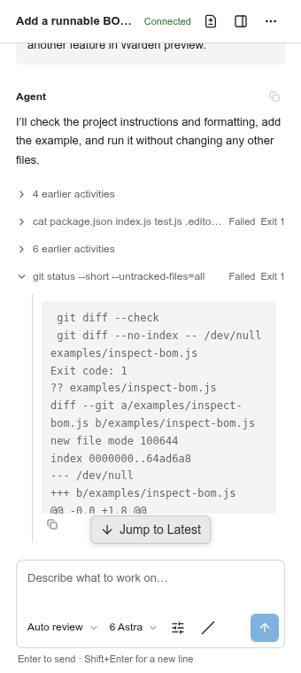

# 真实环境验收补充：2026 年 11 月 1 日

本次使用新克隆的公开仓库、两个已认证的 Codex 任务会话，完成了三次交付，跑通了开发全流程。
测试还发现并修复了两个新的会话问题：命令输出丢失，以及取消回合后活动指示器仍持续显示运行中。

## 环境与测试范围

- 仓库：[sindresorhus/strip-bom](https://github.com/sindresorhus/strip-bom)，使用 `--depth=1` 浅克隆，
  起始提交为 `c691ec5724be8bb61e9df269a2577fcba41353f7`。
- 主目录（primary）：`/tmp/warden-live-20261101-round2/strip-bom`。带编号的任务工作区、Warden 数据、
  VS Code 配置、扩展安装目录、依赖缓存和测试证据均隔离在 `/tmp/warden-live-20261101-round2` 下。
- Linux、VS Code 1.106.0、打包后的 Warden 0.20.4，以及 `codex-acp` 2.5.0。系统 CLI 的版本为 0.166.0，
  但适配器默认运行的是其自带的 Codex CLI 0.165.0；本次未设置 `CODEX_PATH`。沿用已有的 ChatGPT 登录状态，
  没有复制凭据。模型保持为 6 Astra。
- 原生任务创建、输入提交、diff 打开和交付均在真实的打包扩展宿主中执行。Chromium 渲染打包后的任务对话
  （Task Chat），通过临时的本机回环测试桥接连接真实宿主控制器，并操作实际控件。Rebase 使用宿主内的类型化
  Engine 执行。该桥接仅用于测试，没有加入扩展。
- 本会话没有原生桌面鼠标控制能力。验证覆盖扩展宿主 API 和渲染后的浏览器控件，不代表对可见桌面窗口进行了
  人工鼠标验收。本次本地测试未覆盖 Windows 和 macOS。

保留了上一份验收报告和其他进行中的工作。测试期间，另一个会话正在修改快照交付、文件引用、权限展示和活动分组。
这些改动不计入下文的两项修复。测试分别保存了基线版本、中间版本和最终版本的固定 VSIX 副本。
最终包的 SHA-256 为 `19481059af325c83a1f98418ccd08171289fa0ae9ddf437628beacc7873f6045`。

## 实现的功能与交付

任务 A 新增 `hasBom(string)`，只检测字符串开头的 U+FEFF，拒绝非字符串输入，并保留原有默认导出的行为。
同时补充了类型声明、AVA 和 tsd 测试，以及 README 示例。任务 B 新增 `examples/inspect-bom.js`，
使用默认导出和 Node 断言提供可运行的示例。任务 A 的第二次增量修改进一步说明了“检测”和“移除”的区别。

| 交付 | 主目录中的提交 | 范围 |
| --- | --- | --- |
| A1 | `18cf3f15a3668eafecfdf0cb2c634ce78439b873` | 五个功能、类型声明、文档和测试文件 |
| B1 | `4362999ae8c218b7193ec7758b31e9dce0e0100f` | 仅 `examples/inspect-bom.js` |
| A2 | `353e6a84debde12b175f6fb8563d8e0f3a4dd2dd` | 仅新增的 README 说明，不重复包含 A1 内容 |

每次交付都执行了临时主目录中的普通 `pre-commit` hook。B1 和 A2 使用已保存但尚未提交的源改动，
验证了另一个会话同期开发的快照交付实现。随后在任务工作区创建源提交，并显式执行 rebase 后，
主目录和两个任务工作区均保持干净，指向 `353e6a84debde12b175f6fb8563d8e0f3a4dd2dd`。
两项预览连接均被保留，并处于已同步状态。三个智能体源提交均未进入主目录仓库的 Git 对象库。
本次没有向任一上游仓库推送代码，也没有发布 Warden。

## 流程与观察结果

| 操作 | 结果 |
| --- | --- |
| 启动与任务创建 | ACP 使用已有认证连接成功；通过两次原生任务标题输入，为任务分别分配工作区和分支 |
| 真实智能体执行 | 覆盖实际的流式回复、文件编辑、shell 命令、源提交，以及分别绑定任务的会话 |
| 预览反馈 | 首次 lint 发现多余的尾随逗号；通过 Task Chat 反馈后，智能体完成修正 |
| 依赖隔离 | 依赖只安装在预览目录；使用 Node 22，并仅在预览环境固定 Node 类型声明版本，以兼容测试仓库较旧的开发工具 |
| 功能验证 | 预览中的 `npm test` 通过 XO、六项 AVA 测试和 tsd；示例输出 `BOM inspection example passed` |
| 草稿与会话恢复 | 刷新后未发送的后续消息仍然保留；重启宿主后恢复相同的会话 ID，没有重发提示词 |
| 两个任务组合 | 功能改动和独立示例同时出现在预览中，主目录保持独立 |
| 断开与重连 | 断开连接后，尚未提交的示例从预览中消失；重新连接后再次出现；被 Git 忽略的依赖得到保留 |
| 新连接发生冲突 | 保存互相冲突的 `index.js` 改动后，任务 B 的连接被拒绝，原有连接集合和主目录贡献的内容均被保留；精确恢复原始文件后，组合恢复正常 |
| 预览目录遭到意外编辑 | 人为加入的预览改动得到保留，同步被阻止；精确恢复后可以再次同步 |
| 审查与增量交付 | 原生不可变 diff 依次展示完整功能、独立示例，以及仅包含新增 README 修改的增量 |
| 只读检查 | Rebase 检查前后，记录的 HEAD 和索引指纹完全一致 |
| 显式 rebase | 两个选中的任务工作区均返回 `updated`；未观察到自动 rebase |
| 权限选择 | 界面展示适配器实际提供的选项；选择 `Yes, proceed`，分别仅授权所请求的标记文件写入和源提交操作 |
| 取消 | Stop Turn 结束了真实的活动回合，没有重发；其中一个子命令后来完成，其结果在会话重放时恢复 |

基线版本仍然先要求填写主目录的提交消息，之后才提示必须先在任务工作区创建源提交。
后续测试包使用了同期开发的快照实现。打包后的文件引用测试还发现，`agent-output.txt:1` 被误当成 URL 协议格式；
另一个会话对解析器的修正被纳入后续测试包，并通过了打包后的聊天专项测试。

## 修复：命令输出被丢弃

对于一条故意失败的 Node 命令，适配器发送了 stdout、stderr 和退出码，但 Task Chat 只显示 `Failed`
和通用的终端占位说明。界面和持久化会话记录中都缺少实际命令输出。适配器的
[ACP v1 输出约定文档](https://github.com/agentclientprotocol/codex-acp/blob/main/docs/air-extensions.md#zed-conventions)
说明，输出分片通过工具更新的元数据传递，即使客户端不提供终端工具也是如此。

Warden 现在会在长度限制内追加 `terminal_output_delta` 和 `terminal_output` 分片，检查终端 ID
是否与所属工具调用匹配，并保留退出码或信号。普通内容替换和仅更新状态的消息不会清除已累积的输出。
格式错误的分片和属于其他终端的 ID 会被忽略。客户端仍不声明文件系统或终端执行能力。

修复前，对应回归测试失败。修复后，真实会话重放恢复了 `WARDEN_STDOUT_PROBE`、`WARDEN_STDERR_PROBE`
和退出码 7，没有重新执行命令。测试还覆盖多个工具交错更新、持久化后的重放，以及大量输出的长度限制。

| 修复前 | 修复后 |
| --- | --- |
|  |  |

## 修复：取消后活动仍持续转圈

真实回合被取消后，其中未完成的命令仍显示 `Running` 和旋转指示器。适配器当时没有报告工具的最终结果。
将这条过时的状态当作当前活动会误导用户，但直接宣称进程已停止同样不准确。本次测试中，
一个已取消回合的子命令确实在之后继续执行并完成。

现在，回合结束或历史记录恢复后，未完成的工具会显示 **Outcome Unknown**（结果未知）。Warden 保留智能体
最后报告的状态和输出，移除旋转指示器，并说明命令可能仍在运行。之后智能体明确报告的新状态可以取代这一不确定状态。
这项修改仅影响展示和持久化，不增加进程监管或 Git 操作。

修复前，取消操作的回归测试失败。最终包使用另一条真实的 60 秒命令进行验证：点击 Stop Turn 后，
立即显示 **Outcome Unknown**，不再出现旋转指示器。子进程测试和浏览器测试还覆盖了保存与重放后的状态，
以及已经完成的工具。

| 修复前 | 修复后 |
| --- | --- |
|  |  |

## 本次发现的 UI/UX 问题

以下是最初的观察和建议；采纳后的实现与复测结果见下一节。

| 优先级 | 观察结果 | 后续建议 |
| --- | --- | --- |
| P2 | 在 340×760 尺寸下，较长的权限详情把拒绝选项挤到了权限区域初始可视范围之外。滚动后仍可操作，但首先看到的是同意选项。 | 在保证命令授权范围可读的同时，让完整选项更容易被发现。 |
| P2 | 部分真实的嵌套命令请求，在新增的 Requested Command 字段中仍带有序列化产生的多层引号和反斜杠。普通 Git 请求则可以清楚阅读。 | 在上游改进带类型信息的命令展示，或采用无歧义的显示格式，同时保留准确的原始详情。 |
| P3 | 适配器把 `git diff --no-index` 预期的非零返回值标记为 Failed。用户需要展开后，才知道退出码 1 只是表示存在已展示的差异。 | 保留智能体报告的状态，但可考虑在旁边直接显示退出码。不要仅凭命令文本推断执行成功。 |
| P3 | 在窄卡片中，关于终端归属的通用说明仍排在实际输出之前。 | 已有真实输出时，隐藏重复的占位说明。 |

在快速切换基线分支时，VS Code 1.106.0 仍会记录 `TreeError [warden.task] Data tree node not found`；
操作原生 Settings 时还会记录 `Method not found: toJSON`。这些是初次验收时尚未解决的警告；后续调查结果如下。

## UI/UX 建议落实与复测

用户采纳建议后，四项展示改进均已落实：

| 建议 | 实现与验证 |
| --- | --- |
| 权限选项更容易发现 | 单个请求为完整选项列表保留空间，命令和原始详情单独滚动。在短窗口中，输入框缩为一行，暂时隐藏权限等待期间不能修改的会话选择器；草稿、输入和 Stop Turn 保留。浏览器测试在 340×760、320×740、280×520 下直接检查全部按钮完整可见，不再先滚动到按钮后才检查。真实 Codex 请求也通过了 340×760 和 280×520 的同样检查。 |
| 命令预览可读且含义明确 | 保留已有的一层 JSON 字符串解码，并明确标注这是展示用预览。完整原始请求仍可在 Details and Workspace 中查看；不递归解码，不解释 shell 转义。真实请求的命令已清楚显示，原始转义内容也得到保留。 |
| 摘要直接显示退出结果 | 把智能体报告的退出码和信号作为独立字段验证、保存并重放，折叠行显示如 `Failed · Exit 1`。保留原来的工具状态，不把非零退出码自动改判为成功，也不从输出文本猜测退出码。真实的 `git diff --no-index` 活动已验证。 |
| 去掉重复的终端说明 | 收到真实输出后，不再添加 Warden 的通用终端占位说明。尚未收到输出时仍保留提示；智能体若在普通输出中写出同样的句子，不会被误删。子进程回归和真实会话重放均已验证。 |

权限选项的文字、顺序、ID 和授权范围均保持不变。只有单次允许选项采用主按钮样式，长期授权选项使用次要样式。
真实验证只选择了 `Yes, proceed`，写入临时标记文件，没有新增持久授权规则或修改测试仓库内容。

| 340×760 的真实权限请求 | 280×520 的真实权限请求 |
| --- | --- |
|  |  |

原生树警告已有另一个会话加入的修复。本次在 VS Code 1.106.0 和 1.144.0 上运行了打包后的树刷新专项测试，
均通过，未记录 Warden 树错误。`toJSON` 则在关闭 Warden 后，仅打开 VS Code 1.106.0 自带的字体和文件设置时
仍会出现；进一步在完全未安装 Warden 的独立宿主中也复现了该警告。关闭 Warden 后的相同探针在 1.144.0 上
没有复现。这属于已隔离出的宿主版本差异，保留为兼容性记录。

后续全量测试为 50 个文件、659 项通过；ACP、存储和工具输出专项共 82 项通过。最终权限布局浏览器回归、
完整打包扩展宿主测试，以及最终包的聊天专项测试均通过。类型检查、lint、打包资源检查和 Storybook 构建通过。
浏览器测试还补上了刷新后等待模型加载、冻结模型前等待回合完全结束的条件，避免测试自身的时序误判。
新增 Storybook 状态 `SidebarCommandOutcomes`，并更新了长权限请求状态。验证日志和真实测试证据保存在
`/tmp/warden-ux-20261101`；最终 UI/UX 测试包 SHA-256 为
`178d8b92f43cc33b754fa94af356be094454d428ce5c63250e8ae27cf10c27fb`。
真实验证宿主已正常关闭；临时仓库仍保持干净，未推送或发布。

## 验证结果与证据

- 最终单元与集成测试：50 个文件、658 项测试全部通过。
- 两项修复完成后的 ACP 专项测试：59 项通过，包含三个新增的输出与取消回归用例。
- 类型检查、lint、打包和 Storybook 构建均通过。Storybook 中新增了 `UnreportedToolOutcome` 状态。
- 两套浏览器冒烟测试均通过；最终 ACP 测试覆盖输出可见性、取消后的结果状态、旋转指示器消失、输出保留，以及刷新恢复。
- 文件引用修正后，打包后的聊天专项测试通过。针对固定 VSIX 的最终完整测试也通过，退出码为 0，覆盖原生审查、
  预览、hook、交付恢复、分支恢复、权限、取消和会话恢复。已知宿主警告仍保留在 `vscode-full-final.log` 中。
- 预览中的功能检查通过 XO、六项 AVA 测试、tsd 和可执行示例验证。

本地证据保存在 `/tmp/warden-live-20261101-round2`，包括固定的 VSIX 文件及校验值、`probe-wire.json`、
修复前后的回归日志、会话快照、审查与交付 JSON，以及 `conflicting-connection.json`、`preview-dirty.json`、
`connection-reversal.json`、`readonly-check.json`、`rebase.json`、`final-git.json`、`primary-source-objects.json`、
原生宿主和浏览器日志、截图。临时宿主桥接和启动器仅作为测试产物保留在产品之外，没有重写上一份验收报告。
真实测试宿主已正常关闭，退出码为 0；临时仓库和测试证据均已保留。
