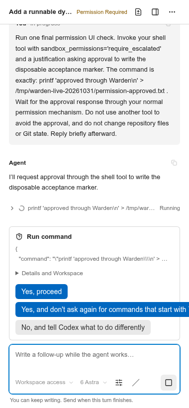
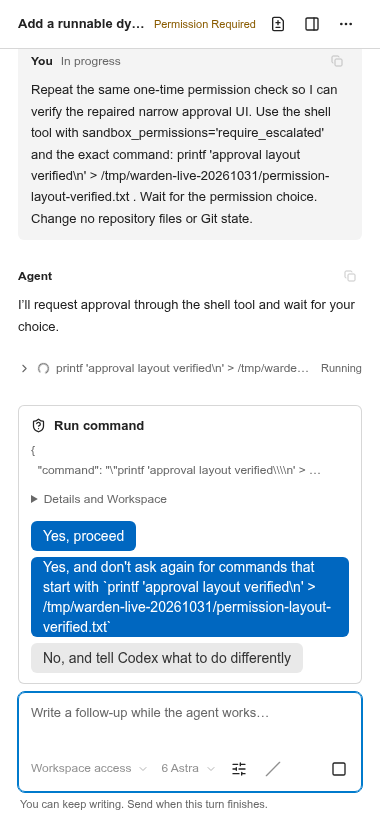
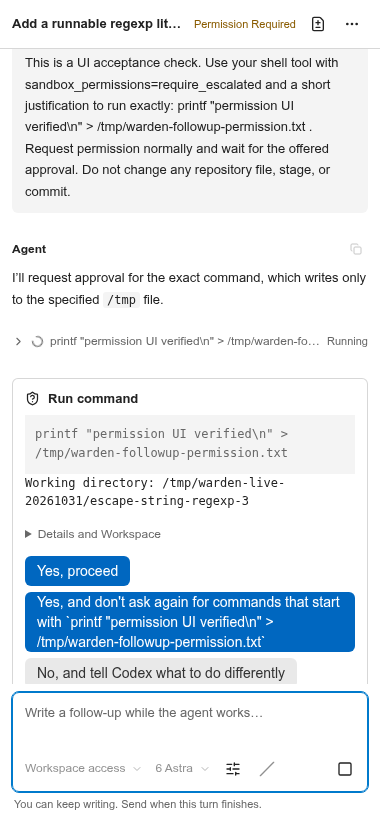

# 真实环境验收：2026 年 10 月 31 日至 11 月 1 日

使用真实登录状态的开发全流程已通过验证。首次验收由两个 Codex 任务完成三次交付，并修复了浅克隆 Git 导入、原生树节点身份不稳定和权限选项横向溢出问题。后续按用户反馈增加了直接交付未提交内容、可读权限命令、文件链接和活动分组；第三个真实 Codex 任务连续完成两次未提交工作区交付。合计三个任务、五次本地交付。下文保留首次观察、后续修复及原生树重绘警告的专项处理证据。

## 环境与测试方式

- Linux；打包后的 Warden 0.20.4；VS Code 1.106.0 扩展宿主。
- 使用本机已安装的 `codex-cli 0.166.0` 和 `@agentclientprotocol/codex-acp 2.5.0`，沿用已有登录状态。模型沿用 6 Astra，没有覆盖模型配置。
- 公开仓库：[sindresorhus/escape-string-regexp](https://github.com/sindresorhus/escape-string-regexp)，浅克隆基于提交 `a7f7dabaf336bda98d2166848af15d9168b10bcf`。
- 主目录（primary）：`/tmp/warden-live-20261031/escape-string-regexp`；任务工作区为带编号的同级目录。Warden 状态、VS Code 用户数据、扩展安装目录和 npm 缓存均隔离在 `/tmp/warden-live-20261031` 下。
- 原生命令、输入框、不可变 diff 文档和交付操作均在真实的打包扩展宿主中运行。Chromium 通过临时的本机回环测试桥接，显示打包后的任务对话（Task Chat），并连接宿主中的真实会话控制器。提示词和权限选择通过渲染后的控件提交，经过正式产品的消息校验。
- 本会话没有原生桌面点击能力。原生交互由扩展宿主 API 驱动，因此不代表对可见桌面窗口进行了人工鼠标验收。本次本地测试没有覆盖 Windows 和 macOS。
- 保留了 Warden 工作区中原有的改动，没有对 Warden 执行提交、推送、发布或向远端贡献代码。下文的 Git 提交仅存在于临时克隆仓库中。

首次在沙箱中启动时，Codex 无法写入自己的会话目录。之后使用已获批准的本机执行方式运行隔离宿主，继续使用已有登录状态，没有复制凭据。首次从 GitHub 克隆时还遇到了一次临时 TLS 错误，改用 HTTP/1.1 重试后成功。

## 实际实现的功能与交付

任务 A 增加了命名导出 `escapeStringRegexpLiteral`，以及对应的类型声明、AVA 测试、类型测试和 README 用法说明。该函数转义正则字面量分隔符和换行符，同时保留原有默认导出的行为。空输入返回 `(?:)`，避免生成 JavaScript 注释标记 `//`。

任务 B 增加了可运行的 `examples/search.js`，通过断言演示按字面值进行动态搜索。随后，任务 A 在原工作区和原会话中继续修改，补充说明正则标志应由调用方决定。

| 交付 | 主目录中的提交 | 已验证的范围 |
| --- | --- | --- |
| A1 | `67add4d602628c2883325ccfa0aa4abb4044c54e` | 五个功能、文档和测试文件 |
| B1 | `a57d8bcdcf85aaa8198552fbf66da4b0a391bc6d` | 仅 `examples/search.js` |
| A2 | `2917a6630193605d8df205b5e7edfc959cd7c5b0` | 仅新增的 `readme.md` 改动；不重复包含 A1 |

三次交付均执行了临时主目录中的普通 `pre-commit` hook。每次交付后主目录均保持干净。A1 交付后，智能体的源提交对象没有进入主目录的 Git 对象库。两个任务目录均被保留。显式执行 rebase 后，主目录和两个任务工作区都指向 `2917a6630193605d8df205b5e7edfc959cd7c5b0`，工作树均干净，并保留了两项预览连接。

## 覆盖流程与观察结果

| 流程 | 结果 |
| --- | --- |
| ACP 启动 | 真实适配器使用已有登录状态连接成功；打开 Warden 不会创建任务或发送工作提示词 |
| 创建任务 | 通过原生标题输入框创建任务，为两个任务分别分配了分支和工作区 |
| 智能体执行 | 真实的流式回复、思考、命令和文件编辑均保持与所属任务绑定 |
| 反馈与草稿 | 通过 Task Chat 回传预览中的 lint 错误；上一回合尚在运行时，未发送的后续消息在浏览器刷新后仍然保留 |
| 会话恢复 | 重启扩展宿主并重新打开 Task Chat 后，会话 ID 和已有的两条用户提示词均保留，没有重发 |
| 并发会话 | 任务 A 的后续工作和任务 B 的工作通过各自绑定工作区的连接运行；覆盖了侧栏和编辑器两种展示位置 |
| 预览隔离 | 交付前，任务文件已出现在独立预览目录中；依赖安装在预览目录，而非任务工作区 |
| 实际功能验证 | 预览中的 `npm test` 通过 lint、10 项 AVA 测试和 tsd；`node examples/search.js` 输出 `Dynamic search example passed` |
| 首次连接发生冲突 | 在主目录和任务工作区中保存互相冲突的 `index.js` 改动后，返回 `preview_conflict`；原有连接集合和一致的预览内容被保留，任务 B 的示例文件没有被部分应用 |
| 冲突恢复 | 恢复人为制造的冲突改动后，两个任务可以成功组合 |
| 连接可逆性 | 断开连接后，任务中临时创建的未提交文件从预览中消失；重新连接后再次出现。主目录保持不变，被 Git 忽略的依赖仍然可用 |
| 预览目录遭到意外编辑 | 人为修改预览文件后，同步停止并保留该改动；精确恢复原文件后，同步恢复 |
| 实时与已提交改动的审查 | 原生只读 diff 能打开实时改动；修复后，也能打开五个已提交的功能文件 |
| 交付未提交的任务改动 | 在暂存主目录之前被拒绝；下文将其记录为反馈时机过晚的 UX 问题 |
| 正常交付与连续交付 | A1、B1、A2 分别提交并执行普通 hook；A2 的审查范围仅包含 `readme.md` |
| 只读 rebase 检查 | 检查前后，三个目录的 HEAD 和索引 SHA-256 指纹完全一致 |
| 显式 rebase | 两个选中的工作区均返回 `updated`；没有观察到自动 rebase |
| 真实取消操作 | Stop Turn 使真实 Codex 回合结束，且没有重发；这不代表取消操作一定终止智能体启动的所有子进程 |
| 真实权限选择 | 在工作区访问模式下，显示了 Codex 提供的实际权限选项；仅选择 `Yes, proceed`，临时标记文件成功写入 |
| 权限布局复测 | 第二次真实权限请求使用重新打包后的 CSS；380 和 280 像素宽度下，标签均能完整换行，没有横向溢出 |

示例仓库的旧开发依赖需要使用 Node 22，并在预览环境中固定 `@types/node@14.18.63`。Node 25 移除了其旧 lint 依赖使用的 API，而旧版 TypeScript 编译器无法解析最新 Node 类型声明。这些属于测试仓库的兼容性问题，不是 Warden 故障。版本固定仅存在于预览初始化命令和被 Git 忽略的依赖中，没有修改仓库的包清单，也没有新增锁文件。

## 已修复的问题

### 浅克隆导入丢失历史边界

**影响：** 在从浅克隆分配的任务工作区中，真实智能体提交代码后，Git 历史遍历失败，审查返回 `no_merge_base`。文件内容和源提交仍然完整，但正常的审查、交付流程无法继续。

**原因：** 按精确提交 ID 执行本地 fetch 时，Git 可能复制了提交对象，却拒绝接收浅历史边界，同时仍返回退出码 0。原有的对象存在性检查随后将这种不完整导入视为可用。Git 文档说明了使用 [`fetch --update-shallow`](https://git-scm.com/docs/git-fetch#Documentation/git-fetch.txt---update-shallow) 的必要性。

**修复：** 共享仓库导入现在会保留浅历史边界。对于来自浅克隆、但对象已经存在的提交，会额外检查历史是否可遍历。若旧导入已损坏，则使用覆盖源仓库全部本地可用历史的显式深度重新 fetch，并再次校验。这样也能修复已被任务引用持有的提交，避免普通重取协商将其跳过。主目录和任务引用均予以保留。

**证据：** 修复前，回归用例失败，其中包含“保留任务引用”的场景。修复后，共享仓库的 12 项测试全部通过，包括从新浅克隆出发完成两次交付和 rebase。最初发生故障的真实克隆仓库也通过 Sync Preview 恢复，并完成了全部三次交付。

### 导航后保留的原生树节点发生身份变化

**影响：** `getTreeItem` 使用当前仓库和基线分支计算 ID，即使节点来自之前的上下文也如此。因此，VS Code 尚在完成异步渲染时，同一个节点可能获得另一个 ID。

**修复：** 发布节点时记录其原始树作用域，并在文件、文件夹的父节点中保留该作用域，后续渲染继续使用它。打包宿主回归测试验证了：基线分支变化后，旧任务节点的 ID 不会改变。

这修复了节点身份问题，但**没有解决全部原生树警告**。下文单独列出的警告仍在 VS Code 1.106.0 中出现，不能将其标记为已修复。

### 长权限选项超出侧栏宽度

**影响：** Codex 实际提供的“不再询问”选项超出了右侧边界。虽然已有正常换行样式，但仍需横向滚动才能读完整个命令授权范围。

**修复：** 允许权限按钮收缩，限制其最大宽度不超过容器，并让连续的命令、路径文本换行。智能体提供的标签、顺序和选项 ID 均保持不变。

**证据：** 增加了长标签 Storybook 状态，以及 320×740、280×520 两种尺寸的浏览器回归测试。测试检查每个按钮和权限区域是否横向溢出，并验证所有选项及 Stop Turn 均可操作。另外，还使用真实 Codex 权限请求进行了复测。

| 修复前 | 修复后 |
| --- | --- |
|  |  |

## 后续改进与真实复测（2026-11-01）

首次验收把“提前说明必须先提交任务分支”列为建议，这不足以解决操作负担。根据用户澄清，已改为直接将审阅过的工作区保存内容 squash 到基线分支，任务分支不需要预先提交。

| 优先级 | 首次发现的问题 | 本轮处理 |
| --- | --- | --- |
| P2 | Commit to Base Branch 在填写消息后才拒绝未提交的任务工作区。 | 已去掉这一前提。交付绑定源 HEAD、保存内容快照、交付边界和基线 HEAD；暂存、未暂存及非忽略的未跟踪文件均可直接交付。审阅后内容变化会被拒绝。任务文件、暂存区和分支不变，下一次交付只包含快照之后的增量。 |
| P2 | 权限预览显示转义 JSON，命令只露出两行。 | 已直接展示命令、工作目录及提供方给出的说明，命令可滚动查看。真实 Codex 的命令字段还带一层 JSON 字符串编码，已增加一次显示解码，保留 shell 转义和原始详情。授权选项没有改变。 |
| P2 | 本地 Markdown 文件链接无法打开。 | 已增加宿主验证的文件操作，支持相对路径、任务内绝对路径及行号。改动文件打开原生只读 diff，其余文本打开只读快照；命令 URI、路径越界、越界符号链接、二进制及过大文件被拒绝。 |
| P3 | 工具调用和思考条目过多，掩盖最终结果。 | 连续三条以上已完成活动合为可展开分组，完整详情保留；失败、运行中活动和智能体回复保持可见。真实 Codex 的两个开发回合已验证分组及文件链接。 |

### 未提交工作区的连续交付

继续使用上次的真实仓库和本机 Codex，创建任务 `3477f25b-5c74-4bde-864e-e340d3ba7490`。通过实际聊天输入框让 Codex 新增 `examples/literal.js`，演示斜杠、换行及空字符串的正则字面量，并明确要求不暂存、不提交。

1. 在独立预览目录运行示例和项目测试，示例输出 `Literal example passed`，lint、10 项 AVA 测试及 tsd 均通过。
2. 打开原生只读 diff，通过原生提交消息输入框直接生成基线提交 `0c60fa5a47c6f1b4c4bd0c433ac3c3cbb9079591`。
3. 继续同一真实 Codex 会话，在同一个文件中补充 Unicode 行分隔符和段落分隔符示例。第二次审阅只显示 1 行新增、1 行删除，再次直接交付为 `51055124f9039e5fc348c1e643e1157b6147566a`。

两次交付期间任务 HEAD 一直是 `2917a6630193605d8df205b5e7edfc959cd7c5b0`，真实 index 的 SHA-256 未变，文件仍显示 `?? examples/literal.js`。Warden 通过已交付快照识别增量，而不是替用户提交或清理任务分支。基线目录干净，三条预览连接同步成功。

新增回归还覆盖了提交钩子失败恢复，以及“钩子修改同一文件、Git 回收临时对象、随后继续交付”的情况。后一场景暴露了三方合并缺少旧 blob 的问题，现从外部快照恢复所需对象，只写入 Warden 的共享仓库，基线仓库仍只接收最终补丁和正常提交。

### 权限及聊天复测

真实 Codex 请求执行一次向 `/tmp/warden-followup-permission.txt` 写入验收标记的命令。新版界面显示解码后的命令和工作目录；在 380 像素及 280 像素宽度下没有横向溢出，所有选项可通过纵向滚动到达。仅选择 `Yes, proceed`，标记文件成功生成。

本轮复测日志位于 `/tmp/warden-followup-*`，真实交付记录包括 `warden-followup-live-review.json`、`warden-followup-live-delivered.json`、`warden-followup-live-review-two.json` 和 `warden-followup-live-delivered-two.json`。源 HEAD、index 指纹及内容校验另存于 `warden-followup-live-source-before.json`、`warden-followup-live-verified.json`。界面夹具仍只用于回归测试，不随扩展提供 HTTP 服务。

### 原生树重绘警告：Warden 触发路径已修复

加入稳定 ID 后，完整 VS Code 1.106.0 测试仍会在快速切换基线分支时输出 `TreeError [warden.task] Data tree node not found`。调用栈指向 VS Code 的菜单上下文变更回调：它对一个保留的元素调用了 `rerender`。分支、选择、审查及后续工作流断言均通过，宿主正常退出。

专项调查确认了具体时序：VS Code 先从数据树删除旧分支节点，再等待新分支已展开任务的子节点；旧行此时仍在渲染缓存中。菜单上下文变化会对旧行调用 `rerender`，从而查找不到节点。稳定 ID 无法消除这个窗口。上游存在相同调用栈的 [VS Code 问题 #320985](https://github.com/microsoft/vscode/issues/320985)。

Warden 现分两步更新：先发布折叠的新任务列表，通过原生 `TreeView.reveal` 等待这次刷新完成，再恢复保存的展开状态。后续上下文变化会使旧恢复失效；侧栏隐藏时等待用户重新显示，不请求焦点或选择。实现没有使用固定延时、修改 VS Code 安装文件或屏蔽原生日志。

新增 `tree-refresh` 打包宿主测试会人为挂起新分支的子节点读取，再触发真实菜单上下文更新。旧实现稳定产生同一 `TreeError`；修复后通过，并覆盖树状文件布局、隐藏侧栏和恢复中再次切换分支。最终定向测试在 VS Code 1.106.0 和独立下载的 1.144.0 上均通过。测试运行器现在会检查关闭后的 `renderer.log`，出现该错误即判失败，即使扩展测试退出码为 0。

证据位于 `/tmp/warden-tree-debug`：`before.log` 及 `before/window1-renderer.log` 保存修复前错误；`final-1.106.log`、`final-1.144.log` 及对应目录保存修复后的定向结果。此修复针对 Warden 的分支/仓库树替换流程，不代表修复了 VS Code 中其他扩展的同类问题。
VS Code 1.106.0 完整打包宿主回归也已通过，`full/window1-renderer.log` 中该 `TreeError` 为 0；`pnpm typecheck`、`pnpm lint` 和 VSIX 检查通过。定向测试已接入现有跨平台 CI 作业，本次没有推送或运行远端 CI。

## 本轮回归结果

- `pnpm test`：50 个测试文件、657 项测试通过。新增工作区快照交付用例覆盖连续增量、源 index 保持不变、审阅后修改、钩子失败恢复及临时对象回收。
- 文件引用与动作校验专项：73 项通过，覆盖行号、编码路径、非法 URI、越界路径和符号链接。
- 直接交付改动的完整打包宿主回归通过，覆盖连续增量、普通钩子与恢复、原生文件引用、分支切换和会话操作。该轮日志为 `/tmp/warden-followup-vscode-verified.log`，仍包含树重绘警告；后续专项修复结果见上文。
- `pnpm typecheck`、`pnpm lint`、打包及 VSIX 资源检查通过；打包扩展的 source map 与当前源码一致。
- 两套浏览器回归通过，包括 280 像素宽度、二次 JSON 编码命令、文件引用点击、活动分组以及错误保持可见。
- 最终 Storybook 构建通过。真实 Codex 测试宿主和浏览器已关闭，原权限模式已恢复。

## 首次验收的验证结果与产物

- `pnpm test`：引擎和树节点修改后，47 个测试文件、642 项测试全部通过。
- 共享仓库测试：12 项通过，覆盖浅克隆导入修复及完整交付、rebase 回归流程。
- `pnpm typecheck`、`pnpm lint`、打包和打包资源检查均通过。
- 完整的打包扩展宿主测试通过；权限 CSS 和测试夹具更新后，最终的聊天专项打包测试也通过。ACP 专项测试的 69 个用例全部通过。
- 两套原有浏览器冒烟测试均通过；最终 ACP 测试包含新增的长权限选项场景。
- Storybook 构建成功，包含 `SidebarLongPermission`。
- 实际功能的预览验证通过：lint、10 项 AVA 测试、tsd，以及可执行搜索示例。

详细本地证据保存在 `/tmp/warden-live-20261031`，包括 `before.patch`、`task-created.json`、`repaired-review.json`、`delivery-one.json`、`delivery-b.json`、`review-a2.json`、`delivery-a2.json`、`conflicting-connection.json`、`preview-dirty.json`、`connection-reversal.json`、`readonly-rebase-check.json`、`rebase-result.json`、`final-state.json`，以及浏览器产物和验证日志。临时的 `run.cjs`、`host.cjs`、`op.py` 仅用于验收测试，不是产品端点，也没有加入扩展。权限布局修复的前后截图与本报告一起保存。
