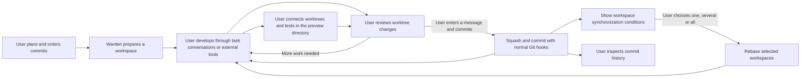

# Warden workflow

Warden is a passive tool tailored to a developer's workflow. The user acts through it rather than
maintaining a separate workflow for it. The user plans, decides, reviews and accepts the work.
Warden supplies workspaces, configurable hooks, task-bound ACP conversations,
diff review, local squash integration and clear commit history. Keep the current version simple enough to support
that loop without turning it into an autonomous agent orchestrator or a project approval system.

This document records the product contract. [Worktrees and tasks](worktrees.md) describes the
working copy; [Implementation alignment](#implementation-alignment) identifies first-version
boundaries. The [interaction design](design.md) records the independently designed page structure.
Earlier proposals for enforced dependencies, agent-owned delivery, task completion declarations,
automatic workspace recycling and automatic rebase are superseded by the decisions below.

## Scope and responsibilities

The primary setting is one developer responsible for a company requirement on a **primary development
branch** (主开发分支), such as `feature/order`. This is not the repository's `main` or default branch.
The primary directory is that branch's checkout; temporary task branches live in worktrees.
The developer decomposes that requirement into small changes, develops them in separate
worktrees, reviews them and adds them to the development branch as commits. Publishing or
merging that branch into the company's main branch remains outside Warden's core workflow.

| Activity | User responsibility | Warden responsibility |
|---|---|---|
| Plan | Decompose the requirement and arrange the work sequence. | Keep one ordered plan of intended commits; TODO and orchestration are the same thing. |
| Prepare | Choose which work to start and how its workspace should be initialized. | Allocate a fresh logical workspace from the development branch and support user-defined workspace hooks. |
| Execute | Choose an agent, send prompts and answer its permission requests, or use external tools. | Provide task-bound ACP conversations and stdio connections; agents execute their own tools and commands. |
| Preview and test | Choose connected worktrees and edit primary code and run the development server, lint or tests in the preview directory. | Compose their live changes in a persistent independent preview, preserving primary Git state. |
| Review | Inspect the worktree's changes and decide whether they are ready to integrate. | Show the complete delivery diff before squash; let the user copy code locations for their own tools. |
| Integrate | Initiate squash, decide what testing is needed, and commit after validation. | Perform the requested Git operations, preserve normal commit hooks, and report their results. |
| Continue | Continue the task and choose when to synchronize its workspace. | Keep the workspace available, show synchronization conditions and rebase only when requested. |
| Organize history | Group related commits and edit their messages; adjust again if needed. | Preview and apply local history edits with conflict feedback; no undo/restore-history feature. |
| Accept the requirement | Inspect commit history and decide whether the requirement is complete. | Provide commit-history review; no separate final-approval feature. |

An agent can run through an explicitly configured ACP stdio connection or through external tools.
Warden uses the generic protocol, without vendor-specific SDKs, structured delivery reports or
process-state inference. Agents own filesystem access, tools, child commands and execution policies;
Warden provides no ACP client filesystem or terminal capabilities, agent sandbox or execution guard.
Every interaction must serve something the user wants to do. Do not ask the user to declare
readiness, idleness or task completion just to keep Warden's records up to date. Display observable
Git state, selected connections and operation results instead. A clean worktree is not an idle agent.

## Plan: the commits making up the requirement

A planned item describes a small task contributing to the requirement's commits. One workspace
corresponds to one task progressing linearly. It can contain multiple local commits and deliver
multiple accepted commits over time, such as A1 and A2 with another workspace's B1 accepted between
them. Squash is the preferred integration method for each reviewed delivery. Splitting a task
into branching execution paths is outside the current scope.

A planned item does not reserve a worktree. Once allocated, a workspace remains available across
deliveries. Warden does not require a task-complete declaration, automatically recycle it after a
commit or add a release-button step. An accepted commit is an observable delivery result, not a
claim that the entire task or requirement has ended.

The primary repository receives only the final commits the user chooses to deliver and push.
Agent source history, trial commits and recovery copies belong to task workspaces or Warden's
external shared repository or data directory. Deliveries apply the reviewed final patch without importing the source
commit graph. Successful operations retire their temporary worktrees and recovery backups;
interrupted operations retain the data their recovery journals still need. User branches and
reflogs are never expired automatically. Default tasks and preview share a Warden-owned Git object
store outside primary, with independent working files, HEADs and indexes. Clone workspaces remain
a compatibility option. Existing primary-linked worktrees deliberately share primary's objects.

The list's order expresses the user's intended work sequence. It does **not** assert that each
item depends on the previous one. Users decide dependencies, parallelism and when to begin a
later item. Warden does not enforce a dependency graph, dispatch tasks automatically or require
an earlier item to be accepted before a later one can start.

Task decomposition is the user's work. There is no dedicated feature for an agent to discover
an oversized task, split it, propose a new task hierarchy or request scope approval. A user may
ask an agent to help with planning through a task conversation or external tools; that requires no
special product workflow. Task notes can hold the detail the user finds useful, without mandatory
acceptance templates or agent-generated reports.

## Workspaces and hooks

A workspace is an execution resource, normally a Git worktree of Warden's external shared repository
on a task branch based on the requirement's development branch. The bare repository lives at
`<primary>-warden/repo.git`, independently of task, preview and temporary operation directories.
Task paths remain `<primary>-<n>`. Warden allocates fresh logical workspaces and exposes initialization hooks. Reusing a free physical directory is an internal implementation detail; users never select or adopt an old workspace.
Workspace creation does not launch an agent. A user can explicitly connect a configured ACP agent
from its task conversation or run external tools. Warden owns only the agent process carrying the
stdio connection; it does not implement ACP terminal tools or supervise agent-started commands.

Workspace hooks are a thin interface for user scripts: execute the configured creation/reuse
command with the workspace directory and context, then expose output and exit status. Scripts
may prepare local configuration or invoke user tools; their internals have no special meaning to
Warden. A failed hook leaves the workspace available and can be retried explicitly. Planning a
task does not run hooks. Creation/reuse hooks do not imply recycling a workspace after delivery.

Workspace hooks are distinct from the repository's normal Git commit hooks. Actual delivery uses
ordinary `git commit` in the development checkout, preserving those hooks and signing.

## ACP connection ownership

A conversation is bound to its original repository, task allocation and workspace identity. Selecting
another task or repository does not retarget its draft, permission requests or review action. Profiles
come from user or remote-user machine settings; task text and workspace configuration cannot supply
executable profiles. See [Working with agents](agent.md) and the [ACP design](acp-design.md).

A cross-window claim permits one executable connection per task. It is connection ownership, not a
lock on task mutations or agent tools. Users coordinate their agent's ongoing work before requesting
Git mutations. Clean Git status, a completed prompt or a cancelled response does not establish that
all agent-started background processes have stopped. Existing Git checks and pinned review remain
necessary; Warden introduces no agent-idle declaration.

Conversation records and session metadata live outside source control. Reload or connection loss
never automatically relaunches an agent or resends an uncertain prompt. Restoration is explicit and
uses the same agent's supported session-loading capability; otherwise a new session retains the old
record without claiming to restore model state. Turn completion never automatically connects preview,
commits, accepts a delivery, rebases or retries an operation.

## Primary directory and temporary connections

Human code is edited and saved in the primary directory; agents edit task workspaces. The baseline
is the primary directory's saved working content, including staged and untracked non-ignored files.
Unsaved editor buffers are not published. New generated previews are persistent worktrees outside
primary, sharing the external Git repository with default task workspaces. Existing standalone
previews keep their directory and repository. Run development servers, tests and debug sessions
there. Shared Git objects do not replace snapshots of uncommitted content.

Connecting workspaces composes their undelivered live changes against that saved baseline. Preview
never modifies primary files, HEAD, index or refs. A conflicting initial connection fails without
changing the selected connections. A later conflict preserves the previous coherent preview and
reports stale/conflict status. Disconnecting removes the selected contributions; with no connections,
the preview still follows saved primary content. Warden does not require isolated delivery testing.

Changes are observed by content hashes and debounced. Each workspace reports pending, updating,
synced, conflict or error based on captured/applied versions. Source edits arriving during composition
are captured by a later update; an agent's clean Git state never establishes idleness. Preview files
are generated and must not be edited. Unexpected runtime edits stop publication without overwriting
them. Publication is journaled and recoverable after a complete old/new write; ambiguous partial
writes remain visible for manual repair.

The runtime directory retains ignored dependencies and caches. A user-configured idempotent setup
script runs on initialization and successful code updates, with manual retry and output/exit status.
It is serialized with publication and receives the primary and preview paths. Scripts decide whether
the environment needs updating; Warden does not interpret dependency manifests.

VS Code is the product entry point. It provides native task diffs, task navigation, review, delivery,
scripts, explicit rebase, history arrangement, preview terminals/tasks and task-bound ACP
conversations for agents that execute their own tools. A preview-versus-baseline or provenance
view is deliberately omitted. See [VS Code](vscode.md) for installation and runtime configuration.

## Review first, then squash

Live review and connection previews include uncommitted workspace content. Delivery review uses
a pinned committed range, its delivery boundary and the primary HEAD. Review has one complete file list. Users must review all content they intend to commit.
Warden recommends small deliveries that the user can review in full. It does not track per-file
read status, provide review checkpoints, or require a review-completion declaration. Staging is not
a review status.
The legacy line/file staging API has been removed. Read-only comparison keys remain available for
explicit comparisons. Formal delivery continues to use the primary checkout's Git index and hooks.

Review takes place against the worktree **before squash**. Selecting its files is already review;
there is no separate review-area navigation step. The user requests further work through the task
conversation or external tools and continues reviewing the result.
Inline comments, their export/reply APIs and feedback/reply CLI commands have been removed.

Delivery is a user action through Warden's integration interaction. It does not require an agent
to announce readiness, run `warden ready` / `warden resume`, submit a structured report, or satisfy
an extra approval gate.

The integration action operates on the change the user reviewed. Ordinary Git checks still need
to prevent an operation from silently using changed source content, overwriting unrelated local
work, or modifying files while the user expects an agent to be working on them. These are
operation checks and visible errors, not an additional agent-delivery or approval workflow.

After complete review, one delivery action composes the increment and commits it in the primary
checkout with normal Git hooks and signing. Message entry happens before any staging; cancellation
leaves Git untouched. Source, delivery boundary or primary-version changes require fresh review.
Tests and dev servers continue in the independent preview, whose connection set stays intact.
Human primary edits must be handled before delivery and cannot be silently included.

Preparation remains an internal journaled step, with explicit recovery after interruption or hook
failure. Recovery shows the retained staged contents or manual commit for review before accepting
that exact version. Workspace actions and VS Code's native commit-message input support this entire
flow without requiring a terminal.

## Continued work and synchronization

Squash preparation alone does not complete a delivery. Its completion event is the commit on the
primary development branch. Warden retains its task, workspace and review association. The workspace
stays available for further commits without a separate “continue” or “finish” declaration. For A2,
make clear which changes have not yet been delivered; A1 must not silently enter the delivery again.

After initial branch configuration, switching the primary checkout through Git or VS Code also switches
Warden's requirement context. The workspace list, selected task, history and synchronization checks
belong to that branch, even when two branches point to the same commit. Returning to a branch restores
its selected task and history draft. Task workspaces keep their original branches, baselines and files;
existing ACP conversations keep their original task. A detached HEAD or an unfinished Git operation
does not select a new requirement. An unfinished delivery preparation or active preview connection
blocks the context switch with a visible explanation; return to the original branch to resolve it first.

When the primary development branch advances, Warden automatically updates synchronization indicators.
It can check whether a workspace needs rebase and whether replay appears
possible without conflicts. Those checks must not change files or the index in an active workspace.
Unknown or stale results remain visibly unknown; a clean checkout alone proves neither replayability
nor that an agent has stopped writing.

The user can request rebase for one workspace, a selected set or all workspaces. Revalidate the source
and destination revisions and current Git conditions at execution time. Report per-workspace results;
an unavailable or blocked workspace must not be silently skipped as a successful synchronization.
Uncommitted changes, conflicting operations or conflicts need a visible explanation and preserved
work, not a readiness checkbox or an automatically sent agent interrupt.

A failed test, hook, squash or synchronization must not silently discard the user's work. Show
what failed and preserve the available changes so the user can decide the next action. Successful
integration is distinct from a later synchronization failure: report the latter
without pretending the accepted commit failed or recreating it.

The user chooses when to perform an operation that changes an active workspace. Warden must not
infer permission to rebase from a clean checkout, sent interrupt or absent terminal output.
Conflicts remain for the user to resolve, possibly with their chosen agent through a custom command.

For the requirement as a whole, commit history is the acceptance interface. Do not add a final
approval screen, requirement-complete gate, separate acceptance state or mandatory whole-requirement
validation flow. Any broader testing and company review remain the user's existing work.

## Organizing accepted commits

Clear history is part of Warden's purpose. Users should be able to edit commit messages and arrange
accepted commits on the primary development branch through the UI. This is distinct from ordering
planned work: reordering the plan must not implicitly rewrite Git history.

For example, worktree 1 delivers A1, worktree 2 delivers B1, then worktree 1 delivers A2. History may
initially be `A1 → B1 → A2`; the user can request `A1 → A2 → B1` to keep related changes together.
Grouping does not imply merging those commits into one. Worktree paths are reusable, so association
must use stable task/delivery identities rather than just a directory name or current commit SHA.

Warden does not provide undo or restoration of a previously applied history arrangement. Users
change the current order or messages again when needed. Discarding an unapplied draft and keeping
the original history on preview failure do not require a history-undo feature.

The first implementation provides a linear history editor. Its operation must preserve:

1. A bounded editable range for this requirement. Keep the company default branch and earlier
   unrelated history outside it. Clarify treatment of merge commits and already-published commits.
2. A preview operation that replays commits in an isolated Git workspace, checks conflicts and
   compares the resulting tree with the original. Reordering can fail even when grouping is useful;
   it cannot be reduced to rearranging visual cards.
3. User-edited messages and an old-to-new commit mapping. Rewording changes a commit's SHA and the
   SHAs of its descendants; preserve review links and delivery associations through that mapping.
4. Explicit application against the same original branch tip and accurate operation-result handling.
   A failed preview must not alter the primary checkout or running worktrees. Do not add undo UI.
5. Interaction with connected previews, commits in validation and sibling worktrees based on the
   previous history. These must be coordinated before replacing the branch tip. Never automatically
   force-push remote history or silently replay already accepted work.
6. Hook, signing, author and committer semantics for rewritten commits. Retain ordinary commit
   hooks for new deliveries; do not assume a low-level commit rewrite has the same behavior.

The user's candidate approach is a backup branch plus a temporary branch: replay commits with
cherry-pick in the requested order, inspect the result and only then update the primary development
branch. The implementation uses an isolated temporary worktree and a journaled external
backup for this sequence, removing both after successful application and bookkeeping. The backup
does not imply a user-facing restoration workflow or a permanent retention ref in the primary repository.
Existing tools and libraries should inform the design; see [research references](design.md#research-references).
The implementation is the internal `@warden/engine` package; a separate repository is not needed for this version.

## Current-version boundaries

Keep the product centered on the ordered plan, workspace creation, configurable hooks,
diff review, squash/commit operations and history. In particular, do not add:

- Agent-driven task decomposition or special scope-change approval features.
- Dependency enforcement, automatic scheduling or automatic concurrency decisions.
- Mandatory agent handoff commands, delivery reports or automatic completion detection.
- Task-complete/idle declarations, automatic workspace recycling or rebase triggered by acceptance.
- ACP client file/terminal tools, an agent shell runner, sandbox or execution guard. Agents own their execution; Warden owns the stdio connection process.
- A custom code editor or preview-versus-baseline diff; native VS Code editing/review is used.
- A separate requirement approval or final acceptance workflow.
- Undo/restore-history actions; users adjust the current history themselves.
- A generic project-management state machine for every pause, interruption or reassignment.

This does not remove the need to retain user data or to report failed Git and command operations.
It keeps decisions with the user instead of turning each decision into another product feature.

## Implementation alignment

The working copy implements the workflow above. It has not been published as a release.

| Operation | Current boundary |
|---|---|
| Plan and workspace | Ordered task notes, explicit allocation, persistent workspaces and repeated deliveries. No completion declaration or automatic recycling. |
| Workspace hooks | Generic creation/reuse scripts with cwd, environment, output and status. Allocation does not launch an agent. |
| ACP conversation | Explicit task-bound text prompts, updates, permissions, authentication, cancel, disconnect and supported session loading. One executable connection per task; agents execute their own tools. |
| Connection | Live committed/uncommitted changes composed in an isolated worktree of the external shared Git repository, then published only to the persistent preview directory. Failed initial connections preserve the prior set and files. |
| Later connection conflict | Preserve the last coherent preview and display stale status; user changes the connections or source work. |
| Delivery | All current undelivered changes from a clean committed source, pinned by reviewed source, delivery boundary and primary HEAD. No file/commit subset picking in this version. |
| Extension commit | Normal primary-directory Git commit with hooks/signing. Failed hooks retain files/index. No test-passed checkbox or agent handoff. |
| Rebase | Isolated checks and explicit single/selected/all execution, with per-workspace results and pinned heads. Actual conflicts are left for the user to handle. |
| History | Select a start through HEAD within the latest 100 commits. Reorder/reword in an isolated cherry-pick preview; apply only linear ranges with identical final tree. No undo or remote push. |
| Navigation | Single left navigation: runtime preview, history, ordered plan, synchronization/settings panels. Selecting a task/file directly opens review. |

`sourceBase` records the last delivered source tip, independently of the squash commit SHA.
Each delivery has a stable identifier and a source range, primary parent, commit, message and
review record. History rewriting updates delivery-to-commit associations; it does not complete
a task or automatically rewrite a source workspace.

Independent preview files have a durable ownership record. An unexpected preview file/index change
blocks replacement rather than being discarded. Interrupted operations recognize only their known
old/new snapshots. This operation bookkeeping is not an undo feature. Users handle unexpected
edits and actual rebase conflicts themselves.

The VS Code extension is the only product entry point. Legacy HTTP adapters exist only in the
regression test harness; no review server, browser application or CLI is shipped. Existing on-disk
state, delivery associations and interrupted-operation journals remain compatible.
