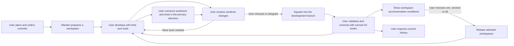

# Warden workflow

Warden is a passive tool tailored to a developer's workflow. The user acts through it rather than
maintaining a separate workflow for it. The user plans, decides, reviews and accepts the work.
Warden supplies workspaces, configurable hooks,
diff review, local squash integration and clear commit history. Keep the current version simple enough to support
that loop without turning it into an autonomous agent orchestrator or a project approval system.

This document records the product contract. [Worktrees and tasks](worktrees.md) describes the
working copy; [Implementation alignment](#implementation-alignment) identifies first-version
boundaries. The [interaction design](design.md) records the independently designed page structure.
Earlier proposals for enforced dependencies, agent-owned delivery, task completion declarations,
automatic workspace recycling and automatic rebase are superseded by the decisions below.

## Scope and responsibilities

The primary setting is one developer responsible for a company requirement on a **primary development
branch** (主开发分支), such as `feature/order`. This is not the repository's `main` or default branch.
The primary directory is that branch's checkout; temporary task branches live in worktrees.
The developer decomposes that requirement into small changes, develops them in separate
worktrees, reviews them and adds them to the development branch as commits. Publishing or
merging that branch into the company's main branch remains outside Warden's core workflow.

| Activity | User responsibility | Warden responsibility |
|---|---|---|
| Plan | Decompose the requirement and arrange the work sequence. | Keep one ordered plan of intended commits; TODO and orchestration are the same thing. |
| Prepare | Choose which work to start and how its workspace should be initialized. | Create or reuse a workspace from the development branch and support user-defined workspace hooks. |
| Execute | Choose and run agents using external tools or user scripts. | Supply the workspace path and generic hook context; execution tools remain outside Warden. |
| Preview and test | Choose connected worktrees and run the development server, lint or tests in the primary directory. | Temporarily compose their live changes there without creating a commit; this capability is planned. |
| Review | Inspect the worktree's changes and decide whether they are ready to integrate. | Show the diff and feedback before squash; let the user export comments for further work. |
| Integrate | Initiate squash, decide what testing is needed, and commit after validation. | Perform the requested Git operations, preserve normal commit hooks, and report their results. |
| Continue | Continue the task and choose when to synchronize its workspace. | Keep the workspace available, show synchronization conditions and rebase only when requested. |
| Organize history | Group related commits and edit their messages; adjust again if needed. | Preview and apply local history edits with conflict feedback; no undo/restore-history feature. |
| Accept the requirement | Inspect commit history and decide whether the requirement is complete. | Provide commit-history review; no separate final-approval feature. |

An agent is a program the user runs in a terminal. Warden does not need an agent-specific SDK,
a structured agent report, process-state inference or its own agent lifecycle protocol.
Every interaction must serve something the user wants to do. Do not ask the user to declare
readiness, idleness or task completion just to keep Warden's records up to date. Display observable
Git state, selected connections and operation results instead. A clean worktree is not an idle agent.

## Plan: the commits making up the requirement

A planned item describes a small task contributing to the requirement's commits. One workspace
corresponds to one task progressing linearly. It can contain multiple local commits and deliver
multiple accepted commits over time, such as A1 and A2 with another workspace's B1 accepted between
them. Squash is the preferred integration method for each reviewed delivery. Splitting a task
into branching execution paths is outside the current scope.

A planned item does not reserve a worktree. Once allocated, a workspace remains available across
deliveries. Warden does not require a task-complete declaration, automatically recycle it after a
commit or add a release-button step. An accepted commit is an observable delivery result, not a
claim that the entire task or requirement has ended.

The primary repository receives only the final commits the user chooses to deliver and push.
Agent source history, trial commits and recovery copies belong to task workspaces or Warden's
external data directory. Deliveries apply the reviewed final patch without importing the source
commit graph. Successful operations retire their temporary repositories and recovery backups;
interrupted operations retain the data their recovery journals still need. User branches and
reflogs are never expired automatically. Clone workspaces provide object-store isolation; linked
worktrees deliberately share the primary repository's objects while development is active.

The list's order expresses the user's intended work sequence. It does **not** assert that each
item depends on the previous one. Users decide dependencies, parallelism and when to begin a
later item. Warden does not enforce a dependency graph, dispatch tasks automatically or require
an earlier item to be accepted before a later one can start.

Task decomposition is the user's work. There is no dedicated feature for an agent to discover
an oversized task, split it, propose a new task hierarchy or request scope approval. A user may
ask an agent to help with planning through their own tools; that requires no special product
workflow. Task notes can hold the detail the user finds useful,
without mandatory acceptance templates or agent-generated reports.

## Workspaces and hooks

A workspace is an execution resource, normally a Git worktree on a temporary branch based on
the requirement's development branch. Warden creates or reuses it and exposes generic hooks.
The user chooses external tools for running agents and sending prompts. Warden has no terminal
session model, agent launcher or process-control API.

Workspace hooks are a thin interface for user scripts: execute the configured creation/reuse
command with the workspace directory and context, then expose output and exit status. Scripts
may prepare local configuration or invoke user tools; their internals have no special meaning to
Warden. A failed hook leaves the workspace available and can be retried explicitly. Planning a
task does not run hooks. Creation/reuse hooks do not imply recycling a workspace after delivery.

Workspace hooks are distinct from the repository's normal Git commit hooks. Actual delivery uses
ordinary `git commit` in the development checkout, preserving those hooks and signing.

## Primary directory and temporary connections

All code editing belongs in task worktrees. The recommended workflow keeps the primary directory
for dependencies, a running development server and user-operated lint/tests. Warden does not edit
code, launch an editor, jump into Neovim, require agents to run tests or install dependencies into
every task workspace. Users can still customize their own scripts.

The user chooses which worktrees to **connect** to the primary directory. A connection continually
projects their live changes into the files used by that directory's existing tools. It is a
temporary combined preview, independent of pre-squash review, integration and commit creation.
It must include in-progress edits rather than only previously committed revisions.

The agreed behavior is user-selected, continuous, temporary composition in the primary directory,
without treating connection as integration or a commit. If establishing a connection conflicts,
notify the user and fail that connection attempt; preserve the previous valid preview and leave
the new workspace unconnected. Do not partially apply it or silently resolve the conflict.

Proposed operation rules to refine, including updates to an established connection, are:

- Compose the selected worktrees against the primary development baseline; leave HEAD and the
  real Git index unchanged. Do not use a commit or squash as the preview mechanism.
- Disconnecting recomposes the remaining connections, or restores the baseline when none remain.
  Restore only files owned by the preview; unexpected edits in the primary directory are not disposable.
- Detect overlapping changes and show conflicts. Never let connection order silently choose a winner.
  A failed update leaves the last coherent preview available and identifies the failed connection.
- Preserve source worktrees. Preview is one-way; changes in the primary directory are not sent back
  into a task. Test fixes are made in the responsible worktree.
- Suspend and remove the temporary preview before formal squash, so other connected worktrees
  cannot enter that commit. Recompose remaining connections against the new baseline afterwards.
- Make interruption and restart recoverable; persisted ownership and baseline information are needed
  before writing files. Do not implement disconnect with a blanket reset or clean.

Connection synchronization uses isolated composition and a periodic refresh in the running server.
Git sees temporary preview files as working-directory modifications; the UI identifies their
contributing workspaces. Delivery preparation removes owned preview contributions before staging.

## Review first, then squash

Review takes place against the worktree **before squash**. Selecting its files is already review;
there is no separate review-area navigation step. The user can export feedback to their own tools
to request more work and continue reviewing the result.

Delivery is a user action through Warden's integration interaction. It does not require an agent
to announce readiness, run `warden ready` / `warden resume`, submit a structured report, or satisfy
a comment-resolution gate. Existing feedback commands can remain useful conveniences, but they
must not become prerequisites for the core workflow.

The integration action operates on the change the user reviewed. Ordinary Git checks still need
to prevent an operation from silently using changed source content, overwriting unrelated local
work, or modifying files while the user expects an agent to be working on them. These are
operation checks and visible errors, not an additional agent-delivery or approval workflow.

Squash collects the reviewed change into the development checkout. The user controls testing
and commit timing. Warden must support entering the commit message and committing directly in the
Web page, running ordinary Git commit hooks. Terminal use is not required for the Web workflow.
Preserve normal hooks when the user also chooses to use Git in the terminal.
Validation on the development branch is not a second product approval
stage, and inspecting the final content does not change the rule that task review precedes squash.

## Continued work and synchronization

Squash preparation alone does not complete a delivery. Its completion event is the commit on the
primary development branch. Warden retains its task, workspace and review association. The workspace
stays available for further commits without a separate “continue” or “finish” declaration. For A2,
make clear which changes have not yet been delivered; A1 must not silently enter the delivery again.

When the primary development branch changes, Warden automatically updates synchronization indicators,
not the task branches. It can check whether a workspace needs rebase and whether replay appears
possible without conflicts. Those checks must not change files or the index in an active workspace.
Unknown or stale results remain visibly unknown; a clean checkout alone proves neither replayability
nor that an agent has stopped writing.

The user can request rebase for one workspace, a selected set or all workspaces. Revalidate the source
and destination revisions and current Git conditions at execution time. Report per-workspace results;
an unavailable or blocked workspace must not be silently skipped as a successful synchronization.
Uncommitted changes, conflicting operations or conflicts need a visible explanation and preserved
work, not a readiness checkbox or an automatically sent agent interrupt.

A failed test, hook, squash or synchronization must not silently discard the user's work. Show
what failed and preserve the available changes so the user can decide the next action. Successful
integration is distinct from a later synchronization failure: report the latter
without pretending the accepted commit failed or recreating it.

The user chooses when to perform an operation that changes an active workspace. Warden must not
infer permission to rebase from a clean checkout, sent interrupt or absent terminal output.
Conflicts remain for the user to resolve, possibly with their chosen agent through a custom command.

For the requirement as a whole, commit history is the acceptance interface. Do not add a final
approval screen, requirement-complete gate, separate acceptance state or mandatory whole-requirement
validation flow. Any broader testing and company review remain the user's existing work.

## Organizing accepted commits

Clear history is part of Warden's purpose. Users should be able to edit commit messages and arrange
accepted commits on the primary development branch through the UI. This is distinct from ordering
planned work: reordering the plan must not implicitly rewrite Git history.

For example, worktree 1 delivers A1, worktree 2 delivers B1, then worktree 1 delivers A2. History may
initially be `A1 → B1 → A2`; the user can request `A1 → A2 → B1` to keep related changes together.
Grouping does not imply merging those commits into one. Worktree paths are reusable, so association
must use stable task/delivery identities rather than just a directory name or current commit SHA.

Warden does not provide undo or restoration of a previously applied history arrangement. Users
change the current order or messages again when needed. Discarding an unapplied draft and keeping
the original history on preview failure do not require a history-undo feature.

The first implementation provides a linear history editor. Its operation must preserve:

1. A bounded editable range for this requirement. Keep the company default branch and earlier
   unrelated history outside it. Clarify treatment of merge commits and already-published commits.
2. A preview operation that replays commits in an isolated Git workspace, checks conflicts and
   compares the resulting tree with the original. Reordering can fail even when grouping is useful;
   it cannot be reduced to rearranging visual cards.
3. User-edited messages and an old-to-new commit mapping. Rewording changes a commit's SHA and the
   SHAs of its descendants; preserve review links and delivery associations through that mapping.
4. Explicit application against the same original branch tip and accurate operation-result handling.
   A failed preview must not alter the primary checkout or running worktrees. Do not add undo UI.
5. Interaction with connected previews, commits in validation and sibling worktrees based on the
   previous history. These must be coordinated before replacing the branch tip. Never automatically
   force-push remote history or silently replay already accepted work.
6. Hook, signing, author and committer semantics for rewritten commits. Retain ordinary commit
   hooks for new deliveries; do not assume a low-level commit rewrite has the same behavior.

The user's candidate approach is a backup branch plus a temporary branch: replay commits with
cherry-pick in the requested order, inspect the result and only then update the primary development
branch. The implementation uses an independent temporary repository and a journaled external
backup for this sequence, removing both after successful application and bookkeeping. The backup
does not imply a user-facing restoration workflow or a permanent retention ref in the primary repository.
Existing tools and libraries should inform the design; see [research references](design.md#research-references).
The implementation is an internal server module; a separate repository is not needed for this version.

## Current-version boundaries

Keep the product centered on the ordered plan, workspace creation, configurable hooks,
diff review, squash/commit operations and history. In particular, do not add:

- Agent-driven task decomposition or special scope-change approval features.
- Dependency enforcement, automatic scheduling or automatic concurrency decisions.
- Mandatory agent handoff commands, delivery reports or automatic completion detection.
- Task-complete/idle declarations, automatic workspace recycling or rebase triggered by acceptance.
- Built-in terminal sessions, agent launch, prompt delivery or process control; user scripts own these choices.
- Embedded editing or editor launch/jump integrations, including Neovim.
- A separate requirement approval or final acceptance workflow.
- Undo/restore-history actions; users adjust the current history themselves.
- A generic project-management state machine for every pause, interruption or reassignment.

This does not remove the need to retain user data or to report failed Git and command operations.
It keeps decisions with the user instead of turning each decision into another product feature.

## Implementation alignment

The working copy implements the workflow above. It has not been published as a release.

| Operation | Current boundary |
|---|---|
| Plan and workspace | Ordered task notes, explicit allocation, persistent workspaces and repeated deliveries. No completion declaration or automatic recycling. |
| Workspace hooks | Generic creation/reuse scripts with cwd, environment, output and status. Agent execution stays in user tools. |
| Connection | Live committed/uncommitted changes composed in an independent temporary Git repository, then written only to primary working files. Failed initial connections preserve the prior set and files. |
| Later connection conflict | Preserve the last coherent preview and display stale status; user changes the connections or source work. |
| Delivery | All current undelivered changes from a clean committed source, pinned by source and primary HEAD. No file/commit subset picking in this version. |
| Web commit | Normal primary-directory Git commit with hooks/signing. Failed hooks retain files/index. No test-passed checkbox or agent handoff. |
| Rebase | Isolated checks and explicit single/selected/all execution, with per-workspace results and pinned heads. Actual conflicts are left for the user to handle. |
| History | Select a start through HEAD within the latest 100 commits. Reorder/reword in an isolated cherry-pick preview; apply only linear ranges with identical final tree. No undo or remote push. |
| Navigation | Single left navigation: primary preview, history, ordered plan, synchronization/settings sheets. Selecting a task/file directly opens review. |

`sourceBase` records the last delivered source tip, independently of the squash commit SHA.
Each delivery has a stable identifier and a source range, primary parent, commit, message and
review record. History rewriting updates delivery-to-commit associations; it does not complete
a task or automatically rewrite a source workspace.

Primary-directory preview files have a durable ownership record. An unexpected file/index change
blocks replacement rather than being discarded. Interrupted operations recognize only their known
old/new snapshots. This operation bookkeeping is not an undo feature. Users handle unexpected
edits and actual rebase conflicts themselves.

Existing low-level checkout and ready/resume HTTP endpoints remain for compatibility, but are
absent from the new UI. Legacy ready does not rebase. The agent CLI exposes feedback/reply only.
