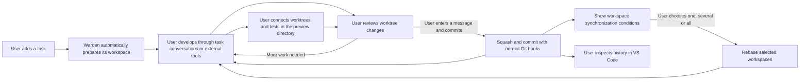

# Warden workflow

Warden is a passive tool tailored to a developer's workflow. The user acts through it rather than
maintaining a separate workflow for it. The user plans, decides, reviews and accepts the work.
Warden supplies workspaces, configurable hooks, task-bound agent interactions,
diff review and local squash integration. Keep the current version simple enough to support
that loop without turning it into an autonomous agent orchestrator or a project approval system.

The current development priority is reliable connections: combine workspace changes in the independent
preview and run tests there. History arrangement is deferred; other existing operations remain available
while their value is assessed against that core loop.

This document records the product contract. [Workspaces and tasks](worktrees.md) describes the
working copy; [Implementation alignment](#implementation-alignment) identifies first-version
boundaries. The [interaction design](design.md) defines the workbench layout and interaction contracts.
The [terminology contract](terminology.md) defines the names used across documentation and the interface.
Earlier proposals for enforced dependencies, agent-owned delivery, task completion declarations,
automatic workspace recycling and automatic rebase are superseded by the decisions below.

## Scope and responsibilities

The primary setting is one developer responsible for a company requirement on a **base branch**, such as `feature/order`. This role does not imply the repository's `main` or default branch.
The primary directory is that branch's checkout; temporary task branches live in worktrees.
The developer decomposes that requirement into small changes, develops them in separate
worktrees, reviews them and adds them to the base branch as commits. Publishing or
merging that branch into the company's main branch remains outside Warden's core workflow.

| Activity | User responsibility | Warden responsibility |
|---|---|---|
| Plan | Decompose the requirement and arrange the work sequence. | Keep one ordered plan of intended commits; TODO and orchestration are the same thing. |
| Prepare | Configure initialization scripts when needed. | Automatically allocate one fresh workspace from the base branch when a task is added and run its configured initialization script. |
| Execute | Choose an agent, send prompts and answer its permission requests, or use external tools. | Bind messages and agent sessions to the assigned task workspace through a supported integration; agents execute their own tools and commands. |
| Preview and test | Choose connected worktrees and edit primary code and run the development server, lint or tests in the preview directory. | Compose their live changes in a persistent independent preview, preserving primary Git state. |
| Review | Inspect the worktree's changes and decide whether they are ready to integrate. | Show the complete delivery diff before squash; let the user copy code locations for their own tools. |
| Integrate | Initiate squash, decide what testing is needed, and commit after validation. | Perform the requested Git operations, preserve normal commit hooks, and report their results. |
| Continue | Continue the task and choose when to synchronize its workspace. | Keep the workspace available, show synchronization conditions and rebase only when requested. |
| Accept the requirement | Inspect commit history and decide whether the requirement is complete. | Use VS Code’s native history view; no separate final-approval feature. |

An agent integration must send messages to an identified session and set or verify that session's
task workspace. ACP is one implementation, not a product requirement; an external application may own
the agent process and interaction UI. See the [minimum integration contract](agent.md#minimum-integration-contract).
The current implementation uses ACP; manually opening an external tool does not establish integration
availability. Warden requires no structured delivery reports or process-state inference. Agents own
filesystem access, tools, child commands and execution policies; Warden provides no ACP client
filesystem or terminal capabilities, agent sandbox or execution guard.
Every interaction must serve something the user wants to do. Do not ask the user to declare
readiness, idleness or task completion just to keep Warden's records up to date. Display observable
Git state, selected connections and operation results instead. A clean worktree is not an idle agent.

Branch tracking is explicit: **Select Base Branch** opts that branch into Warden. Git checkout alone
never tracks a new branch. Untracked branches and detached HEAD show no task, synchronization or preview
status, and automatic preview updates pause without warnings. Returning to a tracked branch restores
its saved context, including tasks, drafts and connections; switching between tracked requirements
retains the existing commit-preparation and preview-connection guards.

An available agent integration is a prerequisite for using the workbench. Warden automatically
connects to the configured ACP server at startup in a trusted workspace and after profile changes.
It initializes an empty session, keeps the connection alive and shows branch selection and task
workspaces once connected. There is no manual connection-check page. Workspace loading and pending
connections hide **Configure ACP**. If the agent still needs user action after loading, Workbench
contains just **Configure ACP**, revealing the native Settings view stacked below it for presets,
connection status, authentication and recovery. Installation or configuration alone does not establish availability.

Connection initialization sends no prompt, grants no tool permission and initiates no Git or preview
operation. Disconnect, replacement, failure and shutdown retire the owned connection process. Task
agents retain separate workspace-bound connections; shutdown closes them and persists their local
records. Opening a task's chat automatically resumes its session or creates the first session;
reopening the workbench alone does not resume task work or replay prompts automatically.
Failures do not trigger a restart loop. Existing tasks, drafts and preview connections are retained.
Other integrations must verify their supported interface without requiring ACP configuration or
Warden ownership of their agent process.

## Plan: the commits making up the requirement

A planned item describes a small task contributing to the requirement's commits. One workspace
corresponds to one task progressing linearly. It can contain multiple local commits and deliver
multiple accepted commits over time, such as A1 and A2 with another workspace's B1 accepted between
them. Squash is the preferred integration method for each reviewed delivery. Splitting a task
into branching execution paths is outside the current scope.

Adding a task automatically allocates its own workspace and task branch. The user supplies task
content, not storage, directory or branch choices. That workspace remains available across deliveries. Warden does not require a task-complete declaration, automatically recycle it after a
commit or add a release-button step. An accepted commit is an observable delivery result, not a
claim that the entire task or requirement has ended.

The primary repository receives only the final commits the user chooses to deliver and push.
Agent source history, trial commits and recovery copies belong to task workspaces or Warden's
external shared repository or data directory. Deliveries apply the reviewed final patch without importing the source
commit graph. Successful operations retire their temporary worktrees and recovery backups;
interrupted operations retain the data their recovery journals still need. User branches and
reflogs are never expired automatically. Default tasks are independent clones with their own object
stores; preview and composition use a Warden-owned shared Git repository outside primary. Existing
shared-repository task worktrees remain supported, and primary-linked worktrees deliberately share primary's objects.

The list's order expresses the user's intended work sequence. It does **not** assert that each
item depends on the previous one. Users decide dependencies, parallelism and when to begin a
later item. Warden does not enforce a dependency graph, dispatch tasks automatically or require
an earlier item to be accepted before a later one can start.

Task decomposition is the user's work. There is no dedicated feature for an agent to discover
an oversized task, split it, propose a new task hierarchy or request scope approval. A user may
ask an agent to help with planning through a task conversation or external tools; that requires no
special product workflow. Task notes can hold the detail the user finds useful, without mandatory
acceptance templates or agent-generated reports.

## Workspaces and hooks

Users may explicitly delete a task, including one with undelivered source commits or saved edits.
One native confirmation identifies the task, workspace folder, branch treatment and discarded work.
Deletion creates no recovery backup. It closes the task's owned agent connection, removes its preview
contribution, releases the workspace and removes the task. Commits already contributed to the base
branch and their minimal historical associations remain. Task notes, drafts and Warden-local chat
records are deleted; the agent application's own history is not managed by this operation.

Releasing a workspace ends its task allocation, normally retaining the physical directory, Git
checkout and ignored environment files. A later task receives a new identity and branch from its
own base; it never inherits the previous task's conversation. A successful commit alone still does
not release a workspace. Pending deletion is an operation record, not a task-completion state.

A connection owned by another window must be disconnected there first. A pending primary commit
belonging to the deleted task must be finished or cancelled before deletion; ordinary primary edits
and unrelated task conversations do not block it. Preview disconnection failure preserves the task
and its workspace. Later cleanup failures retain an explicit retry action and report any already
completed disconnection. Restart never silently resumes destructive cleanup.

A workspace is an execution resource, normally an independent clone of primary with its own `.git`
directory, on a task branch based on the base branch. Preview and temporary operations use Warden's
external shared bare repository at `<primary>-warden/repo.git`.
Task paths remain `<primary>-<n>`. Task creation allocates fresh logical workspaces and runs configured initialization hooks. Reusing a free physical directory is an internal implementation detail; users never select or adopt an old workspace.
Workspace creation does not launch an agent. Opening Task Chat connects its agent session; users can also run
external tools in that directory. In the current ACP integration, Warden owns only the agent process
carrying the stdio connection; it does not implement ACP terminal tools or supervise agent-started
commands. An integration with an externally managed agent must preserve that application's process
ownership.

Workspace hooks are a thin interface for user scripts: execute the configured creation/reuse
command with the workspace directory and context, then expose output and exit status. Scripts
may prepare local configuration or invoke user tools; their internals have no special meaning to
Warden. A failed hook leaves the workspace available and can be retried explicitly. Adding a task
runs its configured hook; editing notes and ordering never run hooks. Creation/reuse hooks do not
imply recycling a workspace after delivery.

If allocation fails, the saved task retains its title, notes and failure reason. Retry prepares that
same task. Legacy unallocated plans are prepared automatically when selected, opened or used for
a conversation; background reads do not allocate them. Archived plans wait for explicit restoration.

Workspace hooks are distinct from the repository's normal Git commit hooks. Actual delivery uses
ordinary `git commit` in the primary checkout, preserving those hooks and signing.

## ACP connection ownership

A conversation is bound to its original repository, task allocation and workspace identity. Selecting
another task or repository does not retarget its draft, permission requests or review action. Profiles
come from user or remote-user machine settings; task text and workspace configuration cannot supply
executable profiles. See [Working with agents](agent.md) and the [ACP design](acp-design.md).

A cross-window claim permits one executable connection per task. It is connection ownership, not a
lock on task mutations or agent tools. Users coordinate their agent's ongoing work before requesting
Git mutations. Clean Git status, a completed prompt or a cancelled response does not establish that
all agent-started background processes have stopped. Existing Git checks and pinned review remain
necessary; Warden introduces no agent-idle declaration.

Conversation records and session metadata live outside source control. Reload or connection loss
never automatically relaunches a task agent or resends an uncertain prompt. Restoration is explicit and
uses the same agent's supported session-loading capability; otherwise a new session retains the old
record without claiming to restore model state. Turn completion never automatically connects preview,
commits, accepts a delivery, rebases or retries an operation.

## Primary directory and temporary connections

Human code is edited and saved in the primary directory; agents edit task workspaces. The baseline
is the primary directory's saved working content, including staged and untracked non-ignored files.
Unsaved editor buffers are not published. New generated previews are persistent worktrees outside
primary, sharing the external Git repository with default task workspaces. Existing standalone
previews keep their directory and repository. Run development servers, tests and debug sessions
there. Shared Git objects do not replace snapshots of uncommitted content.

Connecting workspaces composes their undelivered live changes against that saved baseline. Preview
never modifies primary files, HEAD, index or refs. A conflicting initial connection fails without
changing the selected connections. A later conflict preserves the previous coherent preview and
reports stale/conflict status. Disconnecting removes the selected contributions; with no connections,
the preview still follows saved primary content. Warden does not require isolated delivery testing.

Changes are observed by content hashes and debounced. Each workspace reports pending, updating,
synced, conflict or error based on captured/applied versions. Source edits arriving during composition
are captured by a later update; an agent's clean Git state never establishes idleness. Preview files
are generated and must not be edited. Unexpected runtime edits stop publication without overwriting
them. Publication is journaled and recoverable after a complete old/new write; ambiguous partial
writes remain visible for manual repair.

The runtime directory retains ignored dependencies and caches. A user-configured idempotent setup
script runs on initialization and successful code updates, with manual retry and output/exit status.
It is serialized with publication and receives the primary and preview paths. Scripts decide whether
the environment needs updating; Warden does not interpret dependency manifests.

VS Code is the product entry point. It provides native task diffs, task navigation, review, delivery,
scripts, explicit rebase, preview terminals/tasks and task-bound ACP
conversations for agents that execute their own tools. A preview-versus-baseline or provenance
view is deliberately omitted. See [VS Code](vscode.md) for installation and runtime configuration.

## Review first, then squash

Live review and connection previews include uncommitted workspace content. Delivery review pins
the source HEAD, saved content tree when applicable, delivery boundary and primary HEAD. Saved
uncommitted changes can be delivered without first committing in the task workspace. Review has
one complete file list. Users must review all content they intend to commit.
Warden recommends small deliveries that the user can review in full. It does not track per-file
read status, provide review checkpoints, or require a review-completion declaration. Staging is not
a review status.
The legacy line/file staging API has been removed. Read-only comparison keys remain available for
explicit comparisons. Formal delivery continues to use the primary checkout's Git index and hooks.

Review takes place against the worktree **before squash**. Selecting its files is already review;
there is no separate review-area navigation step. The user requests further work through the task
conversation or external tools and continues reviewing the result.
Inline comments, their export/reply APIs and feedback/reply CLI commands have been removed.

Delivery is a user action through Warden's integration interaction. It does not require an agent
to announce readiness, run `warden ready` / `warden resume`, submit a structured report, or satisfy
an extra approval gate.

The integration action operates on the change the user reviewed. Ordinary Git checks still need
to prevent an operation from silently using changed source content, overwriting unrelated local
work, or modifying files while the user expects an agent to be working on them. These are
operation checks and visible errors, not an additional agent-delivery or approval workflow.

After complete review, one delivery action composes the increment and commits it in the primary
checkout with normal Git hooks and signing. Message entry happens before any staging; cancellation
leaves Git untouched. Source, delivery boundary or primary-version changes require fresh review.
Tests and dev servers continue in the independent preview, whose connection set stays intact.
Human primary edits must be handled before delivery and cannot be silently included.

Preparation remains an internal journaled step, with explicit recovery after interruption or hook
failure. Recovery shows the retained staged contents or manual commit for review before accepting
that exact version. Workspace actions and VS Code's native commit-message input support this entire
flow without requiring a terminal.

## Continued work and synchronization

Squash preparation alone does not complete a delivery. Its completion event is the commit on the
base branch. Warden retains its task, workspace and review association. The workspace
stays available for further commits without a separate “continue” or “finish” declaration. For A2,
make clear which changes have not yet been delivered; A1 must not silently enter the delivery again.

Switching the primary checkout through Git or VS Code restores a previously tracked
requirement context. The task list, selected task and synchronization checks
belong to that branch, even when two branches point to the same commit. Returning to a branch restores
its selected task. Task workspaces keep their original branches, baselines and files;
existing ACP conversations keep their original task. Untracked branches and detached HEAD suspend the
workbench quietly. An unfinished Git operation does not select a new requirement. An unfinished delivery
preparation or active preview connection blocks switching to another tracked requirement with a visible
explanation; return to the original branch to resolve it first.

When the base branch advances, Warden automatically updates synchronization indicators.
It can check whether a workspace needs rebase and whether replay appears
possible without conflicts. Those checks must not change files or the index in an active workspace.
Unknown or stale results remain visibly unknown; a clean checkout alone proves neither replayability
nor that an agent has stopped writing.

The user can request rebase for one workspace, a selected set or all workspaces. Revalidate the source
and destination revisions and current Git conditions at execution time. Report per-workspace results;
an unavailable or blocked workspace must not be silently skipped as a successful synchronization.
Uncommitted changes, conflicting operations or conflicts need a visible explanation and preserved
work, not a readiness checkbox or an automatically sent agent interrupt.

A failed test, hook, squash or synchronization must not silently discard the user's work. Show
what failed and preserve the available changes so the user can decide the next action. Successful
integration is distinct from a later synchronization failure: report the latter
without pretending the accepted commit failed or recreating it.

The user chooses when to perform an operation that changes an active workspace. Warden must not
infer permission to rebase from a clean checkout, sent interrupt or absent terminal output.
Conflicts remain for the user to resolve, possibly with their chosen agent through a custom command.

For the requirement as a whole, commit history is the acceptance interface. Do not add a final
approval screen, requirement-complete gate, separate acceptance state or mandatory whole-requirement
validation flow. Any broader testing and company review remain the user's existing work.

## Organizing accepted commits

Use VS Code's native Source Control Graph to inspect base-branch commits and their diffs.
Warden's history browser and arrangement UI are outside the current scope. The existing engine
implementation and compatibility tests remain available, and stored drafts, delivery records and
operation journals are preserved. Task ordering continues to express the work plan only.

## Current-version boundaries

Prioritize workspace creation, connections, preview setup and testing. The existing ordered plan,
read-only review and delivery/synchronization operations remain available. In particular, do not add:

- Agent-driven task decomposition or special scope-change approval features.
- Dependency enforcement, automatic scheduling or automatic concurrency decisions.
- Mandatory agent handoff commands, delivery reports or automatic completion detection.
- Task-complete/idle declarations, automatic workspace recycling or rebase triggered by acceptance.
- ACP client file/terminal tools, an agent shell runner, sandbox or execution guard. Agents own their execution; Warden owns the stdio connection process.
- A custom code editor or preview-versus-baseline diff; native VS Code editing/review is used.
- A separate requirement approval or final acceptance workflow.
- A generic project-management state machine for every pause, interruption or reassignment.

This does not remove the need to retain user data or to report failed Git and command operations.
It keeps decisions with the user instead of turning each decision into another product feature.

## Implementation alignment

The working copy implements the workflow above. It has not been published as a release.

| Operation | Current boundary |
|---|---|
| Plan and workspace | Ordered task notes, automatic allocation on creation, persistent workspaces and repeated deliveries. No completion declaration or automatic recycling. |
| Workspace hooks | Generic creation/reuse scripts with cwd, environment, output and status. Allocation does not launch an agent. |
| ACP conversation | Explicit task-bound text prompts, updates, permissions, authentication, cancel, disconnect and supported session loading. One executable connection per task; agents execute their own tools. |
| Connection | Live committed/uncommitted changes composed in an isolated worktree of the external shared Git repository, then published only to the persistent preview directory. Failed initial connections preserve the prior set and files. |
| Later connection conflict | Preserve the last coherent preview and display stale status; user changes the connections or source work. |
| Delivery | All current undelivered saved workspace changes, pinned by source HEAD, saved content tree, delivery boundary and primary HEAD. No task commit prerequisite or file/commit subset picking. |
| Extension commit | Normal primary-directory Git commit with hooks/signing. Failed hooks retain files/index. No test-passed checkbox or agent handoff. |
| Rebase | Isolated checks and explicit single/selected/all execution, with per-workspace results and pinned heads. Actual conflicts are left for the user to handle. |
| Navigation | Ordered tasks are top-level sidebar items. Settings is a native collapsible view stacked below Workbench. More Actions offers one preview execution action and Settings, with repository selection and persistent recovery actions when needed. Preview diagnostics use the status bar and output; secondary commands remain in the Command Palette. Selecting a task/file directly opens review. Preview has no editor page. |

`sourceBase` records the last delivered source tip, independently of the squash commit SHA.
Each delivery has a stable identifier and a source range, primary parent, commit, message and
review record. The retained history engine preserves delivery-to-commit associations for compatibility; it is not
invoked by the extension’s navigation or refresh path.

Independent preview files have a durable ownership record. An unexpected preview file/index change
blocks replacement rather than being discarded. Interrupted operations recognize only their known
old/new snapshots. This operation bookkeeping is not an undo feature. Users handle unexpected
edits and actual rebase conflicts themselves.

The VS Code extension is the only product entry point. Legacy HTTP adapters exist only in the
regression test harness; no review server, browser application or CLI is shipped. Existing on-disk
state, delivery associations and interrupted-operation journals remain compatible.
